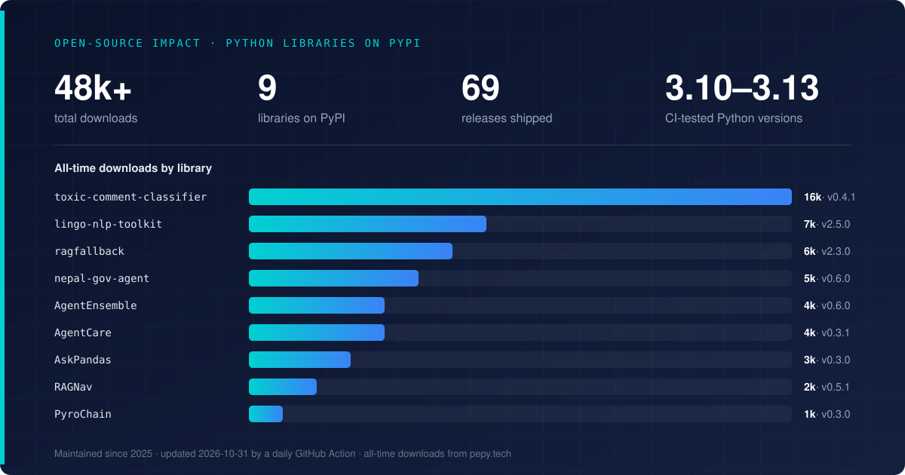
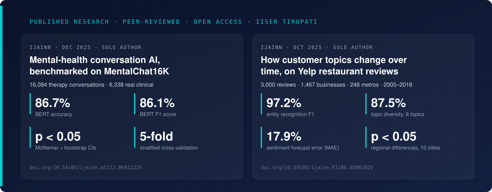

  

   

  
  
  
  
  
  

 

**AI Engineer, based in Bengaluru.** Eight years in data and AI engineering, the last three building AI products end to end, seven of them fully remote with teams in Hong Kong, Europe and India. I build tools that turn messy information into data you can actually use — reading web pages and documents, pulling out what matters, and checking the result is right before anyone relies on it.

Master's in Data Science & AI, IISER Tirupati, 2026 (CGPA 8.9/10). English, Hindi, Bengali, and working Nepali.

**Looking for AI engineering work — Bengaluru or remote. Available immediately.** [irfan.ali@datacortex.in](mailto:irfan.ali@datacortex.in)

## Experience

| Role | Org | When |
| --- | --- | --- |
| AI Engineer | DataCortex · India | Dec 2025 – present |
| Head of AI | Kuration AI · Hong Kong | 2024–2025 |
| Senior Manager (R&D) | Luminous Power Technologies (a Schneider Electric company) · India | 2023–2024 |
| Data Analytics & Automation Associate | Lynk · India | 2022–2023 |
| Head of Data & Analytics | brainsfeed · Hong Kong | 2018–2022 |

## Things I've built

Full writeups at [datacortex.in](https://datacortex.in). Every number below comes from a published source you can check.

### Company-intelligence tool

**Finds 87% of the products a company actually sells, for about 5 cents a company.**

  
  
  
  
  

Reads a company's website and returns the products they sell as organised data, not plain text. It works in five steps: search, read the pages, list candidate products, merge duplicates, then decide which are real. When it isn't sure, it holds the answer back for a person to check.

- **Scored, not eyeballed.** I built the test set: companies whose correct answers I checked by hand, kept fixed so every change is scored against the same list. Nothing shipped unless it held up on that set.
- **Anyone can re-check the score.** The labels, frozen predictions and scoring script are public. `python3 rescore.py` recomputes the numbers with no API keys.
- **Cheap to run.** The full 20-company evaluation cost $1.10 in model and search calls, and no company was left out of the score.

[Case study](https://datacortex.in/work/stacksift) · [Test set and scoring script](https://github.com/irfanalidv/stacksift-eval)

`FastAPI` `DSPy` `Pydantic` `LangSmith` `OpenAI`

### Voice check-in system

**Built so an AI provider outage never loses a call.**

Handles weekly check-in phone calls and writes up what was said. Running in production for evaluation.

- **Safety before any model.** Safety checks run on the raw transcript first and flag anything as critical or elevated.
- **Three layers of fallback.** If one analysis provider fails it moves to the next, then to fixed rules, instead of returning an error.
- **Each call saved exactly once,** even when the phone provider reports the same call twice.
- **Memory without giant prompts.** Context from earlier calls comes from searching past transcripts, not stuffing everything into one long prompt.

[Case study](https://datacortex.in/work/reflecta)

`Next.js` `Bolna` `Groq` `pgvector`

### Godam: trade desk for Nepal's FMCG distributors

**Co-founded and built solo. A live product that replaced four nightly notebooks with one set of books, in daily use by its first distributor.**

  
  
  
  

> "Before Godam, I balanced four notebooks every night — cash, godown, cheques, udhaaro."
> — Sumit Pokhrel, co-founder and first user, Suju Construction & Trading

Stock, sales, cash, cheques, credit and field visits for distributors who supply 40–80 retailers across a district, built for a phone screen.

- **Shaped by daily use.** Built in April 2026, then four rounds of features shipped from the distributor's real requests: receipts and vouchers, bill-by-bill payment matching, cheque reminders, Tally-style statements.
- **Speaks the business's language.** Statements in Nepali (Bikram Sambat) dates, VAT and PAN on every party, sauda (advance deal) book, credit aging, and one-tap PDF sharing on WhatsApp.
- **Built for the field.** Installs on any phone from the browser, because daily sales and collections are entered on the road, not at a desk.
- **Permissions that protect the books.** Owner, staff and view-only roles; view-only users can never change the accounts.
- **No AI in the critical path.** Getting the numbers right comes down to careful data handling and permissions.

[Product site](https://getgodam.com) · [Case study](https://datacortex.in/work/godam)

`Next.js` `TypeScript` `Supabase` `Postgres` `PWA`

## Open source

Python libraries I build and maintain on PyPI. Numbers below refresh daily.

  

<!-- LIBS:START -->
| Library | What it does | Live stats |
| --- | --- | --- |
| [**toxic-comment-classifier**](https://github.com/irfanalidv/toxic_comment_classifier) | Detects toxic comments, with a score per category (toxic, insult, threat and more) |   |
| [**lingo-nlp-toolkit**](https://github.com/irfanalidv/lingo-nlp-toolkit) | Text-processing toolkit on Hugging Face models: classification, entities, sentiment, question answering, summarisation, embeddings |   |
| [**ragfallback**](https://github.com/irfanalidv/ragfallback) | Stops a search-and-answer system failing quietly. Rewrites weak queries, scores how confident the results are, and falls back when they're poor |   |
| [**nepal-gov-agent**](https://github.com/irfanalidv/Nepal-Gov-Agent) | Answers questions about Nepal government policy and legal documents, in Nepali and English, citing the sentence each answer came from |   |
| [**AgentEnsemble**](https://github.com/irfanalidv/AgentEnsemble) | Running several AI agents together: routing work between them, planning, and tracking what it costs. Works with OpenAI or Mistral |   |
| [**AgentCare**](https://github.com/irfanalidv/AgentCare) | Voice AI for healthcare: call intake, pulling out the details that matter, chasing missing information, booking appointments |   |
| [**AskPandas**](https://github.com/irfanalidv/AskPandas) | Ask questions about a CSV in plain English. Runs on a local model by default, so nothing leaves your computer, or on OpenAI / Mistral |   |
| [**RAGNav**](https://github.com/irfanalidv/RAGNav) | Search that combines keyword matching with meaning-based matching, so a question can be found either way. Answers cite the passage they came from |   |
| [**PyroChain**](https://github.com/irfanalidv/PyroChain) | Using AI agents and a fine-tuned language model to work out which features matter in a dataset |   |
<!-- LIBS:END -->

All packages: [pypi.org/user/irfanalidv](https://pypi.org/user/irfanalidv/)

## Papers

  

Sole-author, peer-reviewed (double-anonymised) and open access, written at IISER Tirupati.
Research interests: natural language processing, information extraction, conversational AI, neural information retrieval.

### Advanced cross-validation framework for mental-health AI on MentalChat16K

[*Indian Journal of Artificial Intelligence and Neural Networking*](https://www.ijainn.latticescipub.com/portfolio-item/a111206011225/), vol. 6, no. 1, pp. 10–17, Dec 2025 · sole author · IISER Tirupati

Benchmarks conversation AI for mental-health support on 16,084 therapy conversations (6,338 real clinical interviews). A BERT classifier reaches **86.7% accuracy and 86.1% F1**, and the gaps between models are checked with McNemar's test and bootstrap confidence intervals (p < 0.05) rather than taken at face value. The paper also documents the dataset's limits, including no demographic labels, and states that clinical validation is needed before any real-world use.

Keywords: Mental health · Conversational AI · BERT · Neural networks · Sentiment analysis

### Multi-aspect temporal topic evolution for Yelp review analysis

[*Indian Journal of Artificial Intelligence and Neural Networking*](https://www.ijainn.latticescipub.com/portfolio-item/f110605061025/), vol. 5, no. 6, pp. 10–19, Oct 2025 · sole author · IISER Tirupati

Tracks what restaurant customers talk about, and how it shifts over time, across 3,000 Yelp reviews from 1,467 businesses in 248 metro areas (2005–2018). Combines transformer-based extraction (**97.2% F1** on named entities), topic modelling (eight topics, **87.5% diversity**), sentiment forecasting (17.9% mean absolute error) and city-level comparisons that are statistically tested (p < 0.05 across 10 cities).

Keywords: Topic modelling · Information extraction · Neural-symbolic learning · Temporal analysis · Business intelligence

**Journal:** Indian Journal of Artificial Intelligence and Neural Networking (IJAINN), Lattice Science Publication · ISSN 2582-7626 (online) · indexed in Crossref

## Contact

[irfan.ali@datacortex.in](mailto:irfan.ali@datacortex.in) · [LinkedIn](https://www.linkedin.com/in/irfanalidv/) · [datacortex.in](https://datacortex.in)
